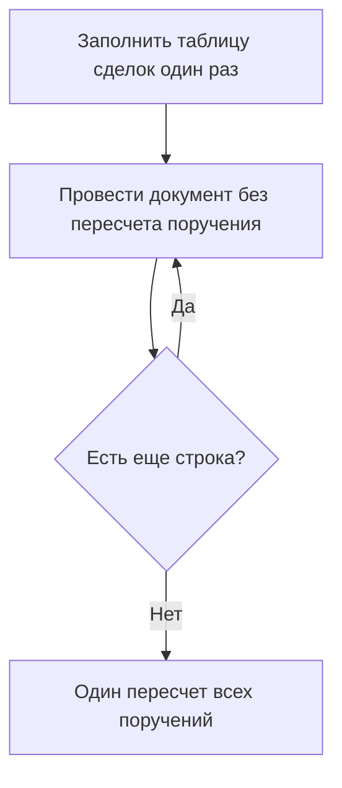

# Исполнение сделок: где теряется время и что проверено на стенде

Дата проверки: 31.10.2026. База проверки: тестовая серверная база ФО. Конфигурацию и рабочую базу не меняли. Тестовые документы после прогонов удалены.

Ночное исполнение создает документ `ИсполнениеПоСделке` на каждую строку плановой позиции и проводит документы по одному. Большая часть времени одного документа уходит на пересчет поручения. Этот пересчет уже умеет принимать список поручений. Его безопасно вызвать один раз после всех проведений. Заменять поштучное проведение одним запросом нельзя.

## Что делает ночь

Регламентное задание `АванкорИсполнениеСделок` в 23:55 вызывает `АванкорВыполнениеРегламентныхЗаданий.ИсполнениеСделок`, затем `Обработки.ГрупповоеИсполнениеСделок.СоздатьДокументыИсполнения`.

Сначала один раз заполняется таблица сделок: остатки `ПлановаяПозиция` на конец дня и сделки с датой поставки на этот день. Затем цикл проводит по одному документу `ИсполнениеПоСделке`. Поток один, обработка ошибки на документ в цикле не стоит.

Проведение пишет расход `ПлановаяПозиция` и задолженность по бумаге или по валюте. После движений документ вызывает `ОбновитьДанныеИсполнения`: расчетный статус поручения, процент исполнения и объем в `РасширенияПоручений`. Вызов идет на одно поручение. Флаг `ДополнительныеСвойства.ОбновитьДанныеИсполнения` уже есть: если он `Ложь`, пересчет внутри проведения не выполняется.

На обычной ФО за ночь бывает 4 356-18 886 документов. 27.10 было 18 886 документов по 9 443 сделкам. Заполнение таблицы на рабочей ФО занимает около 0,7 с. Длительность всей ночи на рабочей базе замером не снята.

В ту же минуту стартует обработка неисполненных и частично исполненных поручений. Она читает признаки регистра статусов: исполнена, отправлено, отменено, исполнено частично, снят остаток. Процент, объем и расчетный статус расширения она не читает.

## Куда уходит время одного документа

На стенде провели настоящий цикл: заполнение таблицы и `Записать` в режиме проведения. Дата поставки тестовых сделок 15.03.2099. Первая сотня документов шла с пересчетом поручения, вторая сотня с флагом `Ложь`. Обмен списком сделок на стенде выключен, время выгрузки XDTO в замер не вошло.

На 100 документах с пересчетом сумма 12,4 с. Медиана одного документа 92 мс.

| Часть | Время на 100 документов | Доля | На один документ |
|---|---:|---:|---:|
| Заполнение таблицы сделок | 0,1 с | 0,7% | один вызов на всю пачку, 85 мс на 200 строк |
| Чтение остатка плановой позиции по ключу | 0,1 с | 0,8% | 1 мс, узкое чтение остатка |
| Запись документа и движений | 5,0 с | 40,2% | входит в 38 мс без пересчета |
| Пересчет поручения внутри проведения | 7,2 с | 58,3% | 54 мс |
| Итого | 12,4 с | 100% | медиана 92 мс |

Без пересчета поручения медиана 38 мс, сумма второй сотни 4,2 с. Эти 38 мс уже содержат запись документа, движения и чтение остатка. Отдельно измеренное чтение остатка по ключу, 1 мс, уже сидит внутри этих 38 мс. Полный текст запроса проведения на пустых данных давал около 13 мс. Его не вычитают из 38 мс второй раз.

Отчет прогона: `bench_regulation_20261031_155519.txt`.

## Что не дает выигрыша

Текст запросов переписывали и мерили на той же базе. Ускорения ночи там нет.

| Что сравнивали | Результат |
|---|---|
| Заполнение: как в коде и вариант "сначала сделки" | 13,8 мс и 20,5 мс, оба 0 строк. Второй медленнее. |
| 20 точечных остатков одним пакетом и один остаток по списку сделок | 86,4 мс и 13,3 мс. Список быстрее, но это не главное время ночи. |
| Запрос проведения как в коде и без точечного отбора | 13,4 мс и 12,9 мс, оба 0 строк. |
| Объем через точку и через шапку во временной таблице | 11,0 мс и 14,7 мс, суммы совпали. |
| Статус на 1 и на 20 поручений, плюс соединение | 12,4 мс, 13,1 мс и 15,9 мс. На 20 поручений время почти не растет. |

Чтение процента и объема уже списочное. Один вызов на 1 поручение: 27,0 мс и 1 строка. Тот же текст на 20 поручений: 30,4 мс и 20 строк.

Отчет: `bench_execution_20261031_150122.txt`.

На стенде у реальных сделок открытой плановой позиции не было, у многих сделок пустое поручение, в шапке поручений пустой тип портфеля. Поэтому регресс чтения и регламент гоняли на созданных документах, а не на ночной выборке рабочей базы. Регистры стенда меньше рабочих. Время стенда нельзя переносить на рабочую ночь как измеренный факт.

## Предлагаемое изменение

В цикле перед записью ставить `ДополнительныеСвойства.ОбновитьДанныеИсполнения = Ложь`. После цикла один раз вызвать `РасширенияПоручений.ОбновитьДанныеИсполнения` по всем поручениям проведенных документов.

Проведение `ИсполнениеПоСделке` остается по одному документу. Заполнение таблицы не трогать. Текст запроса процента не переписывать.



```text
Diagram: Night after the change (flowchart)
  [Zapolnit tablicu] --> [Provesti dokument bez perescheta]
  [Provesti dokument bez perescheta] --> {Est esche stroka?}
  {Est esche stroka?} -- Da --> [Provesti dokument bez perescheta]
  {Est esche stroka?} -- Net --> [Odin pereschet vseh porucheniy]
```

## Почему список не заменяет проведение

Ключ плановой позиции включает сделку. Проведение сделки A не уменьшает остаток сделки B. Бумага и деньги одной сделки - разные активы. Поэтому остаток для следующего документа нельзя посчитать одним снимком на все сделки сразу, если документы все равно надо провести по своим ключам.

Общее состояние - поручение. Несколько исполнений уменьшают `ЗадолженностьПоБумаге` или `ЗадолженностьПоВалюте`. Измерение там только поручение. Расчетный статус читает этот долг.

Процент исполнения долг проведенных документов не читает. Для обычной сделки это

`(Количество поручения - остаток ПрогнозПоПоручению) / Количество поручения`.

Объем - цена поручения, умноженная на количество в распределении по портфелям. Проведение `ИсполнениеПоСделке` прогноз и цену поручения не пишет.

Для поручения с заполнением по сумме процент берет сумму поручения и суммовой остаток прогноза. Для РЕПО остаток берется из `ПланПоПоручению`. Проверенный сценарий - обычная сделка, не заполнение по сумме и не РЕПО.

## Проверки

### Список читает то же, что тысяча отдельных вызовов

Тысяча поручений, чтение без проведения исполнения. 900 помечены проведенными, у 150 из этих 900 есть остаток прогноза. Тысяча отдельных вызовов: 25,4 с. Один список из 1000, медиана трех замеров: 203 мс (200, 204, 203). Это 125 раз на чтении. Расхождений чисел нет, различных пар процент/объем 787.

Отчет: `bench_execution_1000_20261031_152728.txt`.

Этот прогон не доказывает, что один вызов в начале ночи верный. Он доказывает только равенство текстов при одинаковых данных.

### Пересчет до проведений оставляет старый статус

Три поручения, по четыре сделки. Начальный долг 40, каждое исполнение списывает 10. Процент и цена снаружи не менялись.

После сделок долг был 30, 20, 10 и 0. Пока долг был, расчетный статус оставался промежуточным. На последней сделке, когда долг стал 0, статус стал итоговым. Процент все четыре раза 1,0000, объем все четыре раза 1000,00.

Один пересчет до проведений: 3 из 3 не совпали с поштучным финалом, статус остался промежуточным. Проведения без повторного пересчета: снова 3 из 3 со старым статусом. Один пересчет после всех проведений: 3 из 3 совпали, итоговый статус, процент 1,0000, объем 1000,00.

### Процент и объем меняются только снаружи

Одно поручение, количество 40, четыре сделки. Перед каждой сделкой снаружи записывали остаток прогноза 30, 20, 10, 0 и цену 100, 110, 120, 130.

| После сделки | Статус | Процент | Объем |
|---|---|---:|---:|
| 0 | промежуточный | 0,2500 | 4000,00 |
| 1 | промежуточный | 0,5000 | 4400,00 |
| 2 | промежуточный | 0,7500 | 4800,00 |
| 3 | итоговый | 1,0000 | 5200,00 |

Это прямо формула: (40 - 30) / 40 = 0,25 и дальше 20, 10, 0. Объем: 100 x 40 = 4000 и дальше 110, 120, 130. Один пересчет после всех проведений, когда прогноз уже 0 и цена уже 130, дал тот же финал: итоговый статус, 1,0000, 5200,00. Промежуточные 0,25, 0,50 и 0,75 он не записал.

Первый прогон при этом остается в силе: пока прогноз и цену не трогают, процент и объем между сделками стоят на месте, хотя долг и статус меняются.

Оба прогона в отчете `bench_sequence_20261031_161047.txt`.

## Когда один пересчет в конце безопасен

1. Вызов стоит после всех проведений. Вызов до проведений и ночь без пересчета оставляют старый расчетный статус.
2. К моменту вызова прогноз, цена и количество поручения уже в конечном состоянии. Списочный пересчет пишет только последнее состояние.
3. Между проведениями никто не читает `РасширенияПоручений` и расчетный статус, чтобы принять решение. Цикл группового исполнения эти поля между документами не читает. Соседняя обработка в 23:55 читает другие признаки статуса. Отчет или другой сеанс, который читает именно расширение или расчетный статус посреди ночи, до конца увидит утреннее значение.

## Как читать ускорение

3,8 раза относится только к пачке чтений пересчета, не ко всей ночи. На иллюстрации 18 886 документов эта пачка сжимается с 16 мин 08 с до 4 мин 17 с, потому что чтение плановой позиции на каждый документ остается.

Полное проведение на стенде: 92 мс с пересчетом и 38 мс без него. 92 / 38 = 2,4 раза.

Если перенести стендовую цену на 18 886 документов, получается около 29 минут сейчас и около 12 минут после изменения, плюс один списочный вызов. 18 886 x 92 мс = 28,96 мин. 18 886 x 38 мс = 11,96 мин. Это арифметика стенда, не замер рабочей ночи. На рабочей базе регистры больше, время может быть выше.

13,6 мс на документ из таблицы чтений заново к 38 мс не прибавляют: чтение плановой позиции в 38 мс уже есть.

3,2 с на 18 886 поручений - верхняя стендовая оценка списка. В ночи поручений меньше, чем документов: 27.10 было 18 886 документов на 9 443 сделки, в прогоне последовательности 12 документов на 3 поручения. Список короче, время списка меньше.

## Что в конфигурации не сделано

Флаг в цикле группового исполнения не включали. Это описание проверки, не готовая доработка. Параллельное проведение по портфелям, обработка ошибки одного документа и отбор даты поставки в виртуальной таблице в этих прогонах не проверялись.

## Уточнение по цене итогового пересчета (31.10.2026)

Оценка 3,2 с выше получена по копии текста запроса без записи. Замер самой процедуры `РасширенияПоручений.ОбновитьДанныеИсполнения` с записью в оба регистра на 1000 поручений: 27,9 мс на поручение одним списком против 72,8-218,2 мс по одному, регресс записи совпал (отчет `bench_execution_write_20261031_164202.txt`). Верхняя оценка итогового вызова на 9 443 поручения - 4,4 мин, ночь - около 16 мин вместо около 29, примерно в 1,8 раза. Подробно - `Проверка предложения по исполнению сделок - разбор кода.md`.

## Параллельное проведение: предварительная оценка

Проверено только по коду, не замерено. Отложено до внедрения одного пересчета в конце и замера ночи на ПРОД.

- Возможно: у `ПлановаяПозиция`, `ЗадолженностьПоБумаге`, `ЗадолженностьПоВалюте` включено разделение итогов, явных управляемых блокировок в проведении `ИсполнениеПоСделке` нет.
- Делить по поручениям, а не по портфелям: задолженность ведется только по поручению, все документы одного поручения должны идти в одном потоке.
- Только без пересчета внутри проведения: иначе потоки одновременно пишут статус одного поручения. Схема: дирижер раздает поручения по потокам с весом по числу документов, потоки проводят без пересчета, дирижер ждет все потоки и один раз пересчитывает пачками.
- Образец деления на потоки у вендора - `РасчетПрогнозированияСервер`; метода БСП `ВыполнитьФункциюВНесколькоПотоков` в этой версии нет.
- Риски для замера: общий нумератор документа (сквозная автонумерация), нагрузка на сервер в 23:55, сбой в одном потоке (`Попытка` на документ и пересчет проведенных поручений при любом исходе).
- Ориентир: 12 мин проведения на 4 потоках - около 3-4 мин плюс итоговый пересчет, если нумератор не тормозит.
