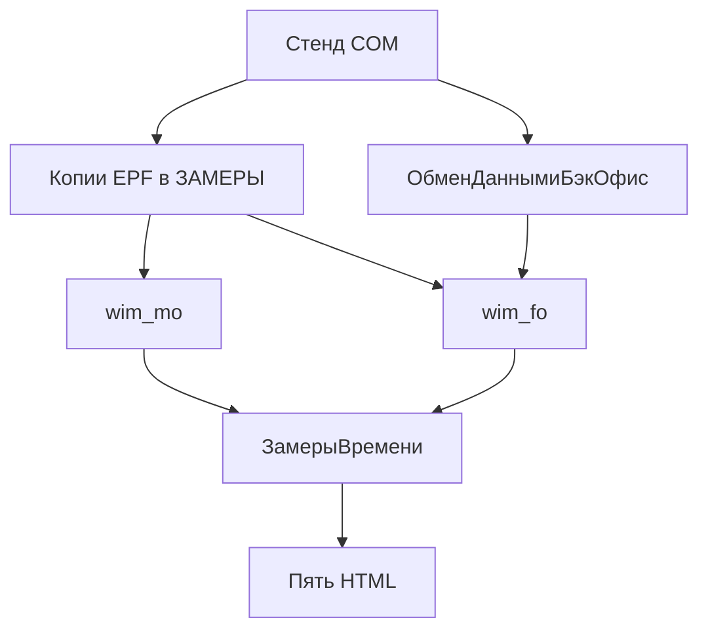
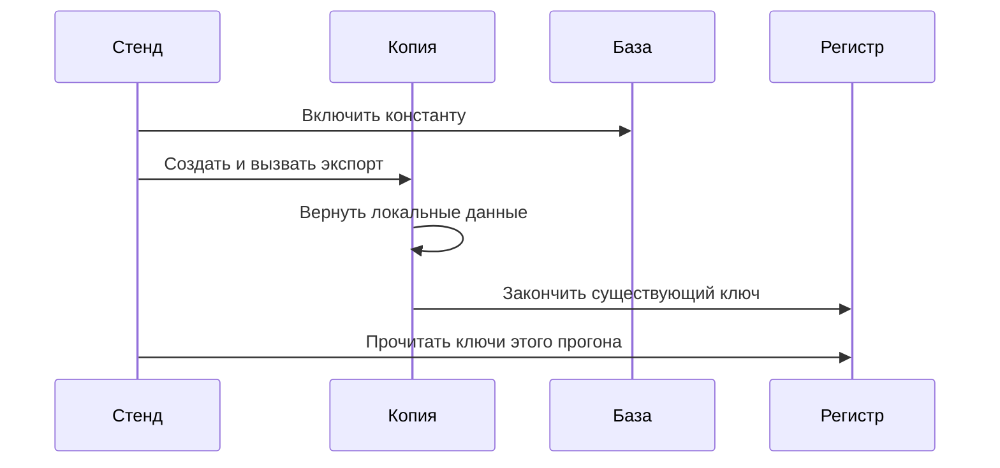
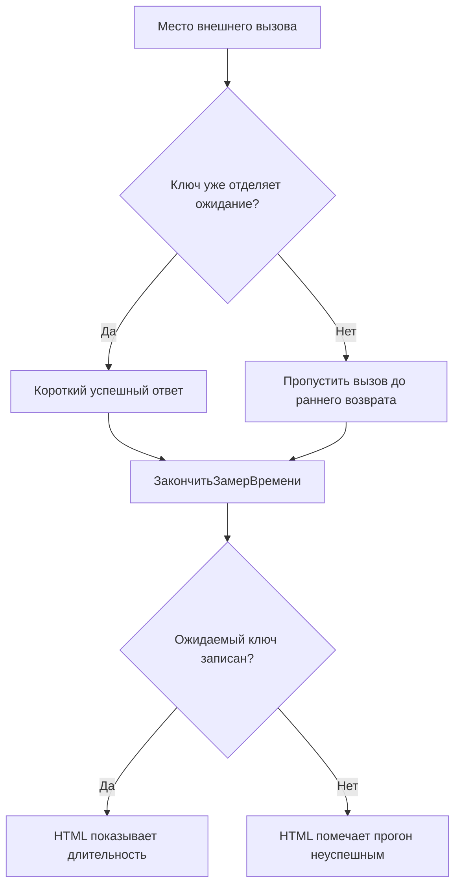
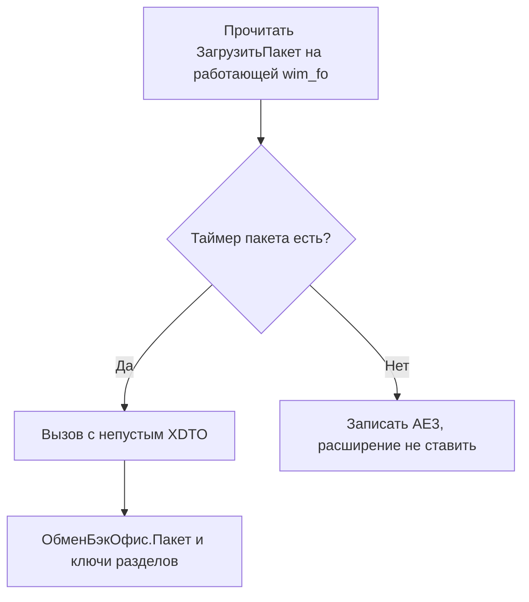

# Замеры загрузок уровня 5 - Plan

## Goal Capsule

- Objective: Разработчик открывает по одному отчету на каждую из пяти задач и видит, записала ли этот прогон ключи замера на разработческих базах и какой шаг октябрьский профиль уже отмечает к последующей доработке.
- Means: Копии с замерами и COM-стенд на `wim_fo` и `wim_mo`. Внешние вызовы заменены локальными данными (KTD1, KTD3).
- Authority: Product Contract выше Planning Contract, тот выше единиц работы. Key Decisions важнее порядка работ в плане уровня 5.
- Stop conditions: Если у `ЗагрузитьПакет` на работающей базе ФО нет таймера пакета, прием не запускать и написать это в отчете приема. Расширение `FO_KeyOpsPerf` не ставить. Прогон без ожидаемого ключа считается неуспешным.
- Execution: code. Исполнитель готовит отчеты. Ускорение начинается только после разбора этих отчетов.

## Product Contract

### Summary

Пять загрузок уровня 5 получают маленький синтетический стенд на разработческих базах. У каждой обработки остаются ее нынешние ключи замера, прогон идет без боевых сервисов, и на каждую задачу приходится один HTML. У мандатов и котировок МО-ФО в том же файле есть и выгрузка из МО, и прием на ФО. Файлы в `ОРИГИНАЛЫ` не меняются. Ускоренная копия в этот проход не собирается.

### Problem Frame

Октябрьские замеры прода уже показывают, куда уходит время трех загрузок ФО. Котировки ММВБ большую часть запуска в 116-141 секунд проводят внутри одного шага чтения. TCRIS около 96 процентов из 32-35 секунд тратит на запись. Индексы заканчиваются за 10-11 секунд. По мандатам и котировкам МО строк прода нет.

Разработческие базы не вызывают боевой сервис котировок, Rates и публикацию ФО. Копии в `ОРИГИНАЛЫ` уже содержат крупные ключи. Неудачный внешний вызов возвращается раньше `ЗакончитьЗамерВремени`, и пустая заглушка не пишет строку. Этот проход нужен, чтобы ключи записались на малой выборке и у каждой обработки было отдельное чтение этих строк рядом с октябрьским профилем.

### Key Decisions

- KD1. Только синтетические данные. Ключ, который уже отделяет ожидание внешней системы, получает короткий успешный ответ. Ключ, который это ожидание не отделяет, получает локальную замену, и шаг все равно доходит до записи замера. (session-settled: user-directed - chosen over live StockPrice, Rates, and the FO web publication: the stand must not depend on those systems.) Governs R1, R3.
- KD2. Уменьшенный объем, несколько строк на загрузку. (session-settled: user-directed - chosen over a production-sized sample: the stand checks the path.) Governs R2.
- KD3. Мандаты и котировки МО-ФО замеряются и на выгрузке, и на приеме ФО. (session-settled: user-directed - chosen over measuring only the MO export.) Governs R4.
- KD4. Пять HTML, по одному на задачу. Прием ФО входит в файлы мандатов и котировок МО-ФО. Ускоренной копии в этом проходе нет. (session-settled: user-directed - chosen over a sixth file for the FO receive processing and over an original-versus-sped-up pair: one report per task.) Governs R5, R6.

### Requirements

**Стенд**

- R1. Каждая из пяти загрузок выполняется на разработческих базах из синтетических данных, и ее нынешние ключи замера пишутся в `РегистрСведений.ЗамерыВремени`.
- R2. На каждую загрузку хватает нескольких строк, чтобы шаг дошел до записи замера.
- R3. Ключ, который уже отделяет ожидание внешней системы, получает на этот шаг короткий успешный ответ. Ключ, который ожидание не отделяет, внешнюю систему не вызывает, и локальные шаги все равно доходят до записи замера.

**Обе стороны**

- R4. Мандаты и котировки МО-ФО записывают выгрузку из МО и прием на ФО отдельными замерами.

**Отчеты**

- R5. У каждой из пяти задач свой HTML с временами шагов этого прогона и с местами к доработке из октябрьского профиля. В файлах мандатов и котировок МО-ФО есть обе стороны.
- R6. Файлы в `ОРИГИНАЛЫ` остаются без изменений. Ускоренная копия в этот проход не собирается.
- R7. Прогон без ожидаемого ключа в HTML этой обработки помечается как неуспешный.
- R8. Строки, созданные на разработческих базах, получают префикс стенда и перечисляются в отчетах.

### Key Flows

- F1. Загрузчики ФО
  - **Trigger:** Стенд создает копию через `ВнешниеОбработки.Создать` и вызывает `ВыполнитьКоманду`.
  - **Steps:** Копия возвращает локальные данные, модуль пишет ключи шагов и общий ключ, стенд читает регистр.
  - **Covered by:** R1, R3, R7
- F2. Выгрузка МО
  - **Trigger:** Стенд вызывает `Выгрузить` или `Опубликовать`, переменная `ЕстьЗамер` не установлена.
  - **Steps:** Копия собирает пакет локально, вызов публикации пропускает и пишет ключ шага.
  - **Covered by:** R1, R3, R4
- F3. Прием ФО
  - **Trigger:** Заглушка выгрузки пакет на ФО не доставила.
  - **Steps:** Стенд вызывает `ЗагрузитьПакет` с небольшим непустым пакетом. Метод конфигурации пишет `ОбменБэкОфис.*`.
  - **Covered by:** R4, R7

### Acceptance Examples

- AE1. Котировки ММВБ проводятся
  - **Covers:** R1, R3
  - **Given:** Копия не вызывает `WSОпределения` хоста котировок, и несколько синтетических котировок можно провести.
  - **When:** Выполняется `ВыполнитьКоманду`.
  - **Then:** Записаны `ЗагрузкаКотировокММВБ`, `ЗагрузкаКотировокММВБ.Чтение` и `ЗагрузкаКотировокММВБ.Запись`.
- AE2. Сопоставление TCRIS
  - **Covers:** R1, R3
  - **Given:** Копия возвращает таблицу значений с одним ИНН, который совпадает с контрагентом стенда, и соединение с Rates не открывает.
  - **When:** Выполняется `ВыполнитьКоманду` с идентификатором команды `ФоновоеВыполнение`.
  - **Then:** Записаны `ЗагрузкаTCRIS`, `ЗагрузкаTCRIS.ЧтениеRates`, `ЗагрузкаTCRIS.Сопоставление` и `ЗагрузкаTCRIS.Запись`.
- AE3. На ФО нет таймера пакета
  - **Covers:** R4
  - **Given:** У `ЗагрузитьПакет` на работающей базе ФО нет таймера пакета.
  - **When:** Дошли до приема.
  - **Then:** В файлах мандатов и котировок МО-ФО написано, что прием не замерялся. Расширение не устанавливается.
- AE4. Нет ключа
  - **Covers:** R7
  - **Given:** Обработка завершилась без одного ожидаемого ключа.
  - **When:** Пишется ее HTML.
  - **Then:** Прогон помечен как неуспешный. Пустой шаг не описывается как быстрый.

### Success Criteria

- Есть пять HTML, по одному на задачу. Каждый ожидаемый ключ либо записан, либо прогон помечен как неуспешный. Если таймера пакета нет, в файлах мандатов и котировок МО-ФО написано, что прием не замерялся, и эта сторона не помечается как неуспешный прогон.
- Длительности стенда и октябрьский профиль стоят в разных колонках. Длительность заглушки не подается как узкое место прода.
- После прохода содержимое `ОРИГИНАЛЫ` не изменилось.

### Scope Boundaries

- Пять загрузок: котировки ММВБ, индексы, TCRIS, мандаты МО-ФО и котировки МО-ФО.
- Разработческие базы - уже существующие профили `wim_fo` и `wim_mo`.
- Весь проход лежит только в папке проекта `bases/Wim_Fo/projects/Уровень 5 Загрузка данных/`. Этот план - файл `План замеров уровня 5.md` в корне папки. Стенд, копии и HTML из папки проекта не выносятся.
- HTML-отчеты лежат в `Тестирование/reports/` этой папки. Постановки и сопроводительные заметки, если они появятся, пишутся в `Документация/` этой же папки.

#### Deferred to Follow-Up Work

- Разделить ключ чтения ММВБ на сервис, разбор и построчный лог.
- Писать TCRIS только при изменившемся значении.
- Неделя наблюдения на проде по мандатам и котировкам МО.
- Сборка ускоренных копий и сравнение их с оригиналами.
- Тот же прием записи, что у TCRIS, для индексов. Октябрьский профиль уже считает индексы уложенными в окно.

### Sources

- План работ с октябрьскими цифрами: `bases/Wim_Fo/projects/Уровень 5 Загрузка данных/План работ - задачи уровня 5.md`. Фраза, что в оригиналах замеров нет, неверна. Модули ФО уже вызывают `ОценкаПроизводительности`, у модулей МО ключи крупнее.
- Раскладка копий и создание через COM: `bases/Wim_Fo/projects/IMDEV-9530  Замеры ФО/`.
- Префикс синтетических элементов и прямые вызовы выгрузки: `bases/Wim_Fo/projects/IMDEV-9532 Оптимизировать загрузку остатков портфелей из МО в ФО/Тестирование/Стенд_МО_ФО/`.
- Форма HTML, без колонок «оригинал против замера»: `bases/Wim_Fo/projects/IMDEV-9530  Замеры ФО/Тестирование/Отчет о тестировании замеров, этап 5.html`.
- Ключи приема ФО уже есть в выгрузке `1.4.10.3`: `DataProcessors/ОбменДаннымиБэкОфис/Ext/ObjectModule.bsl` в `wim_fo`, рядом с `НачалоЗамераПакета` и `ОбменБэкОфис.Пакет`.
- На эту выгрузку не ставить `bases/Wim_Fo/projects/IMDEV-9530  Замеры ФО/ЗАМЕРЫ/FO_KeyOpsPerf`. Тот же таймер уже в методе конфигурации, и проверка расширения не применится.
- Перенаправление хостов и `mock_load_services.py` не использовать. Они оставляют ожидание внешней системы внутри `.Чтение`.
- Каталога `docs/solutions` нет. Записанных там ограничений на эти решения нет.

---

## Planning Contract

### Key Technical Decisions

- KTD1. Пять внешних обработок копируются в `ЗАМЕРЫ` и правятся только там. Ключи в копиях уже есть, второй раз их не вставлять. Замена стоит на том пути, который сейчас возвращается раньше `ЗакончитьЗамерВремени`. Неудачное соединение строку не пишет, поэтому замена возвращает тот успешный вид данных, которого ждет проверка шага. Это механизм для KD1.
- KTD2. ММВБ, индексы и TCRIS входят через `ВыполнитьКоманду` на COM-объекте. Мандаты входят через `Выгрузить` для `Мандаты` и `СчетаМандатов`. Котировки МО входят через `Опубликовать`, `ЕстьЗамер` не устанавливается. Регламентная команда МО ключи шагов прячет.
- KTD3. Прием ФО - это вызов `ЗагрузитьПакет` у `Обработки.ОбменДаннымиБэкОфис` через COM. Отдельной EPF для копирования нет. Перед вызовом прочитать метод работающей базы. Если таймера пакета нет, действовать по AE3.
- KTD4. Пять файлов отчета, по одному на задачу: котировки ММВБ, индексы, TCRIS, мандаты МО-ФО, котировки МО-ФО. Ключи приема `ОбменДаннымиБэкОфис` входят в два последних файла, отдельного файла приема нет. Времена стенда и октябрьский профиль стоят в разных колонках. Места к доработке берутся из плана уровня 5. У мандатов и котировок МО октябрьских строк нет, и отчет это пишет.
- KTD5. На время прогона в обеих базах включена `ВыполнятьЗамерыПроизводительности`. Прежнее значение сохраняется и возвращается после отчетов. Объекты создаются через `ВнешниеОбработки.Создать`, предупреждение об опасных действиях отключено. Зарегистрированная дополнительная обработка в безопасном режиме делает окончание замера пустым.
- KTD6. Уменьшенный набор индексов пишется в реквизит `СписокИндексов`. Пустая `НастройкаРассылки` не должна выбросить исключение до записи `ЗагрузкаИндексов`. У котировок МО `Заполнить` не вызывается: этот запрос читает все активы с признаком CRIMS.
- KTD7. Копия TCRIS соединение с Rates не открывает. Логин и пароль из `ПодключитьсяКRates` в отчеты, журналы и комментарии не попадают.

Второй вариант заглушки, замена только внутреннего метода сервиса, отпадает по самим модулям. ММВБ, индексы, TCRIS и обе выгрузки МО возвращаются раньше окончания замера, когда этот внутренний вызов падает. Новой формы хранения для такого выбора не нужно, отдельного сравнения вариантов не было.

### High-Level Technical Design

Стенд владеет данными, вызовами и отчетами. Копии владеют заменой внешнего вызова. Обработка конфигурации владеет ключами приема ФО.

Схема: состав (блок-схема)



```text
Схема: состав (блок-схема)
  [Стенд COM] --> [Копии EPF в ЗАМЕРЫ]
  [Стенд COM] --> [ОбменДаннымиБэкОфис]
  [Копии EPF] --> [wim_mo]
  [Копии EPF] --> [wim_fo]
  [ОбменДаннымиБэкОфис] --> [wim_fo]
  [wim_fo] --> [ЗамерыВремени]
  [wim_mo] --> [ЗамерыВремени]
  [ЗамерыВремени] --> [Пять HTML]
```

Схема: один замер (последовательность)



```text
Схема: один замер (последовательность)
  Стенд -> База : Включить константу
  Стенд -> Копия : Создать и вызвать экспорт
  Копия -> Копия : Вернуть локальные данные
  Копия -> Регистр : Закончить существующий ключ
  Стенд -> Регистр : Прочитать ключи этого прогона
```

Схема: где стоит замена (блок-схема)



```text
Схема: где стоит замена (блок-схема)
  [Место внешнего вызова] --> {Ключ уже отделяет ожидание?}
      {отделяет?} -- Да --> [Короткий успешный ответ]
      {отделяет?} -- Нет --> [Пропустить вызов до раннего возврата]
  [ответ] --> [ЗакончитьЗамерВремени]
  [пропуск] --> [ЗакончитьЗамерВремени]
  [ЗакончитьЗамерВремени] --> {Ожидаемый ключ записан?}
      {записан?} -- Да --> [HTML показывает длительность]
      {записан?} -- Нет --> [HTML помечает прогон неуспешным]
```

Схема: прием ФО (блок-схема)



```text
Схема: прием ФО (блок-схема)
  [Прочитать ЗагрузитьПакет на работающей wim_fo] --> {Таймер пакета есть?}
      {таймер?} -- Да --> [Вызов с непустым XDTO]
      {таймер?} -- Нет --> [Записать AE3, расширение не ставить]
  [Вызов] --> [ОбменБэкОфис.Пакет и ключи разделов]
```

### Sequencing

1. U1 сохраняет константу и проверяет таймер ФО.
2. U2 готовит данные с префиксом. U3, U4 и U5 можно писать после U1. U5 ждет U2, если пакету нужны эти ссылки.
3. U6 запускается после U2, U3, U4 и U5. U7 пишет отчеты по выгрузке U6.

### Risks & Dependencies

| Риск | Что происходит | Как снимается |
|---|---|---|
| Работающая база ФО старше выгрузки 1.4.10.3 | `ЗагрузитьПакет` не пишет строку `ОбменБэкОфис.*` | KTD3 и AE3. Расширение не ставить |
| Константа осталась выключенной | Каждое окончание замера пустое, регистр не пополняется | KTD5. U1 останавливает стенд, если пробное окончание ничего не записало |
| Замена стоит только на внутреннем вызове | Модуль возвращается раньше окончания замера | KTD1. U6 считает отсутствие ключа неуспехом |
| `Опубликовать` котировок МО все еще доходит до пересчета РСА | Тот же ключ снова вызывает публикацию по всем портфелям | Копия пропускает все три вызова публикации, по KTD1 |
| Учетные данные TCRIS попадают в отчет | Пароль лежит в исходной функции | KTD7 |
| Строки стенда остаются в разработческих базах | После прогона остаются документы, элементы справочников и `ДополнительныеСведения` | R8. Отчеты перечисляют префикс, по нему строки можно удалить |

### Output Structure

```text
bases/Wim_Fo/projects/Уровень 5 Загрузка данных/
  План замеров уровня 5.md           этот план
  ОРИГИНАЛЫ/                         без изменений
  ЗАМЕРЫ/
    ФО/                              три копии EPF
    МО/                              две копии EPF
  Тестирование/
    stand/                           стенд и подготовка данных
    fixtures/                        локальный WSDL и малые пакеты
    reports/                         пять HTML, по одному на задачу
```

### Documentation / Operational Notes

Отчеты - это результат тестирования разработчика, каталог `Тестирование/reports/`. В бизнес-папку `Документация` они не кладутся. После U7 константа замеров возвращается к значению, которое сохранил U1. Отчеты называют префикс стенда и не содержат логин и пароль Rates.

---

## Implementation Units

### U1. Стенд и включение замеров

- **Goal:** COM-стенд открывает обе разработческие базы, включает замеры и сообщает, есть ли уже таймер пакета у метода приема на работающей ФО.
- **Requirements:** R1, R7. Механизм: KTD3, KTD5.
- **Dependencies:** нет
- **Files:**
  - `bases/Wim_Fo/projects/Уровень 5 Загрузка данных/Тестирование/stand/stand_common.py`
  - `bases/Wim_Fo/projects/Уровень 5 Загрузка данных/Тестирование/stand/check_fo_timer.py`
- **Approach:**
  - Параметры подключения читать так же, как `stand_common.py` стенда IMDEV-9532.
  - По каждой базе сохранить прежнее значение константы и включить замеры.
  - Внешние обработки создавать с отключенным предупреждением об опасных действиях.
  - Сделать одно пробное окончание замера. Если в регистре не появилась строка, остановиться.
  - Прочитать `ЗагрузитьПакет` на работающей базе и записать, есть ли таймер пакета.
- **Execution note:** Пробная строка на `wim_fo` должна появиться до копирования пяти обработок.
- **Patterns to follow:** `bases/Wim_Fo/projects/IMDEV-9532 Оптимизировать загрузку остатков портфелей из МО в ФО/Тестирование/Стенд_МО_ФО/stand_common.py`
- **Test scenarios:**
  - Константа была выключена. После пробы в регистре есть новая строка, а сохраненное прежнее значение - выключено.
  - Константа уже была включена. Возврат оставляет ее включенной.
  - `wim_fo` не подключается. Стенд останавливается и данные не создает.
  - Проверка таймера ФО возвращает «есть» или «нет». «Нет» выбирает AE3 для следующих единиц.
- **Verification:** Обе базы принимают сеанс COM, пробная строка видна, результат проверки таймера записан.

### U2. Данные с префиксом

- **Goal:** В обеих базах есть небольшой набор элементов стенда, с которым дальше можно сопоставиться.
- **Requirements:** R2, R8.
- **Dependencies:** U1
- **Files:**
  - `bases/Wim_Fo/projects/Уровень 5 Загрузка данных/Тестирование/stand/prepare_data.py`
- **Approach:**
  - Один префикс на каждый создаваемый элемент.
  - На `wim_fo` создать несколько активов, два индекса и одного контрагента с непустым ИНН. Если свойства с именем TCRIS нет, создать его с этим точным именем и числовым типом и перечислить в отчете U7. Остальные строки стенда сохраняют префикс. Загрузчик ищет свойство по этому имени.
  - На `wim_mo` создать несколько мандатов и счетов мандатов с `Выгружать`, готовым к выгрузке.
  - Второй запуск находит те же элементы и дубликаты не создает.
- **Patterns to follow:** `prepare_mo.py` стенда IMDEV-9532, стиль префикса `T9532`.
- **Test scenarios:**
  - Первый запуск создает контрагента, активы, индексы и мандаты с префиксом. Второй запуск сохраняет те же количества.
  - Контрагент с пустым ИНН в сопоставление TCRIS не попадает.
  - Свойства с именем TCRIS нет. Подготовка создает числовое свойство с этим именем, второй запуск второе такое свойство не создает.
  - Элемент с префиксом стенда, который создал не этот стенд, останавливает подготовку.
  - Элементы ФО есть только на `wim_fo`, мандаты только на `wim_mo`.
- **Verification:** Следующие единицы находят свои ссылки с префиксом, и список в отчете U7 совпадает с тем, что создала эта единица.

### U3. Копии загрузчиков ФО

- **Goal:** ММВБ, индексы и TCRIS пишут свои нынешние ключи из локальных данных.
- **Requirements:** R1, R2, R3, R6. Механизм: KTD1, KTD2, KTD6, KTD7. Примеры: AE1, AE2.
- **Dependencies:** U1
- **Files:**
  - `bases/Wim_Fo/projects/Уровень 5 Загрузка данных/ЗАМЕРЫ/ФО/внЗагрузкаКотировокММВБ_epf/`
  - `bases/Wim_Fo/projects/Уровень 5 Загрузка данных/ЗАМЕРЫ/ФО/внЗагрузкаИндексовФО_epf/`
  - `bases/Wim_Fo/projects/Уровень 5 Загрузка данных/ЗАМЕРЫ/ФО/ЗагрузкаДопРеквизитаTCRIS_epf/`
- **Approach:**
  - Скопировать три дерева из `ОРИГИНАЛЫ/ФО`. `ОРИГИНАЛЫ` и дерево замеров IMDEV-9530 не править.
  - ММВБ: не выполнять `WSОпределения` хоста котировок. Подать несколько строк котировок, которые `СоздатьОбъекты` может провести. Одного `ТестовыйРежим` мало: он все равно попадает в этот конструктор, поэтому заменой не служит.
  - Индексы: источник по умолчанию остается MICROAPI. Вернуть данные с `IndexData` и `IndexComposition`. Уменьшенный набор держать в `СписокИндексов`, даже если `ВыполнитьКоманду` передает пустой список. Пустую `НастройкаРассылки` закрыть до записи общего ключа.
  - TCRIS: заменить чтение так, чтобы оно вернуло таблицу значений с колонками `Rater`, `IssuerName`, `IssuerINN`, `Rating`, `RatingSubLev`, `DateUpdated`, `AsOfDate` и `prioritet`. Один `IssuerINN` совпадает с контрагентом U2. Соединение с Rates не открывать.
- **Patterns to follow:** Вызовы ключей уже есть в этих модулях объектов. Вторую пару тех же ключей не добавлять.
- **Test scenarios:**
  - Команда ММВБ пишет общий ключ, `.Чтение` и `.Запись`, и соединения с хостом котировок нет.
  - Строка ММВБ, которую нельзя провести, оставляет `.Запись` и общий ключ незаписанными. Это неуспех, а не быстрая запись.
  - Команда индексов по двум индексам с префиксом пишет `ЗагрузкаИндексов`, `.Чтение` и `.Запись` и не читает весь справочник индексов.
  - Индексы с пустой настройкой почты все равно пишут общий ключ.
  - Команда TCRIS пишет все четыре ключа и Rates не открывает.
  - Таблица TCRIS с неверным набором колонок пишет самое большее `.ЧтениеRates`, дальше прогон неуспешен.
  - Различий в `ОРИГИНАЛЫ/ФО` нет.
- **Verification:** Правлены только три копии, и по тексту каждой замены видно, что она стоит до раннего возврата.

### U4. Копии выгрузки МО

- **Goal:** Разделы мандатов и котировки МО пишут ключи шагов и публикацию ФО не вызывают.
- **Requirements:** R1, R3, R4, R6. Механизм: KTD1, KTD2, KTD6.
- **Dependencies:** U1
- **Files:**
  - `bases/Wim_Fo/projects/Уровень 5 Загрузка данных/ЗАМЕРЫ/МО/внВыгрузкаСчетовМандатов_МО_ФО_epf/`
  - `bases/Wim_Fo/projects/Уровень 5 Загрузка данных/ЗАМЕРЫ/МО/внВыгрузкаКотировокМО_ФО_epf/`
  - `bases/Wim_Fo/projects/Уровень 5 Загрузка данных/Тестирование/fixtures/`
- **Approach:**
  - Скопировать оба дерева из `ОРИГИНАЛЫ/МО`.
  - Мандаты: вызвать `Выгрузить` при `ВыгрузитьПоУзлу` = ложь и `Выгружать` = истина. Фабрику XDTO взять из файла WSDL в `fixtures`, не из публикации ФО и не из пустого `АдресWS`. `DownloadPosition` и `ВыполнитьРаспространениеПравил` возвращаются без HTTP.
  - Котировки: `ЕстьЗамер` не устанавливать и `Заполнить` не вызывать. Положить несколько строк в `Котировки` и вызвать `Опубликовать`. Пропустить установку соединения и все три вызова публикации, включая пересчет РСА и почтовый признак РСА. `АдресWS` остается ссылкой на справочник.
- **Patterns to follow:** Стенд IMDEV-9530 вызывал `Выгрузить` и `Опубликовать` напрямую. Эта копия убирает публикацию, которую те вызовы выполняли.
- **Test scenarios:**
  - `Выгрузить("Мандаты")` и `Выгрузить("СчетаМандатов")` пишут каждый свой `..._Выгрузить_<раздел>_Сервер`.
  - Пустой `АдресWS` или `ВыгрузитьПоУзлу` = истина ключ шага не пишут, прогон неуспешен.
  - `Опубликовать` с тремя строками в памяти пишет `..._Опубликовать_Сервер` и публикацию не вызывает.
  - `ВыполнитьКоманду` на копии котировок пишет только ключ команды. Это не точка замера.
  - Различий в `ОРИГИНАЛЫ/МО` нет.
- **Verification:** Поиск по обеим копиям не находит вызова, который доходит до `DownloadPosition` на живом прокси.

### U5. Пакеты приема ФО

- **Goal:** Небольшой пакет мандатов и небольшой пакет котировок пишут ключи приема конфигурации.
- **Requirements:** R4, R7. Механизм: KTD3. Пример: AE3.
- **Dependencies:** U1, U2
- **Files:**
  - `bases/Wim_Fo/projects/Уровень 5 Загрузка данных/Тестирование/stand/receive_packets.py`
- **Approach:**
  - Если U1 записал, что таймера нет, `ЗагрузитьПакет` не вызывать. Сохранить для U7 результат AE3. Это не неуспех из-за отсутствующего ключа.
  - Собрать один пакет справочников с непустыми разделами портфелей, субпортфелей, мест хранения и счетов, на ссылках U2.
  - Собрать один пакет документа котировок на несколько строк.
  - Вызвать `ЗагрузитьПакет` у созданного `ОбменДаннымиБэкОфис`. `DownloadPosition` не вызывать.
- **Patterns to follow:** Форма `send_packet` стенда IMDEV-9530, направленная на метод обработки, а не на публикацию.
- **Test scenarios:**
  - Таймер есть. Пакет справочников пишет `ОбменБэкОфис.Пакет` и ключи `ОбменБэкОфис.Справочники` по заполненным разделам.
  - Таймер есть. Пакет котировок пишет `ОбменБэкОфис.Пакет` и `ОбменБэкОфис.Документы.КотировкиЦБНаБирже`.
  - Пустой раздел ключ раздела не пишет. Ключ пакета при этом может быть.
  - Таймера нет. `ЗагрузитьПакет` не вызывается, результат - AE3.
- **Verification:** Ключи регистра совпадают с фактически заполненными разделами, либо результат - AE3.

### U6. Прогон замеров

- **Goal:** По каждой обработке один записанный прогон либо пишет ожидаемые ключи, либо сохраняется как неуспех.
- **Requirements:** R1, R7. Потоки: F1, F2, F3.
- **Dependencies:** U2, U3, U4, U5
- **Files:**
  - `bases/Wim_Fo/projects/Уровень 5 Загрузка данных/Тестирование/stand/run_measurements.py`
  - `bases/Wim_Fo/projects/Уровень 5 Загрузка данных/Тестирование/stand/last_run.json`
- **Approach:**
  - ММВБ, индексы и TCRIS запустить через `ВыполнитьКоманду` на `wim_fo`. У TCRIS идентификатор команды `ФоновоеВыполнение`.
  - Две выгрузки МО запустить на `wim_mo` через входы из KTD2.
  - U5 запустить на `wim_fo`.
  - Прочитать `ЗамерыВремени` только этого прогона. Сохранить ключ, длительность, вес и комментарий.
  - Отсутствующий ожидаемый ключ помечает обработку неуспешной и нулевой длительностью не заполняется.
- **Execution note:** Если у обработки нет первого ожидаемого ключа, остаток этой обработки не продолжать, остальные обработки продолжать.
- **Test scenarios:**
  - Полный прогон сохраняет ключи ММВБ и TCRIS из AE1 и AE2, `ЗагрузкаИндексов` с `.Чтение` и `.Запись`, два ключа выгрузки мандатов, ключ публикации котировок МО и ключи разделов ФО из U5. Если таймера пакета нет, запись приема ФО - это результат AE3, а не неуспех.
  - Одна обработка падает с исключением. Ее статус неуспешен, у остальных обработки строки остаются.
  - Ключи пробного замера U1 в `last_run.json` не входят.
  - Регламентный вход МО точкой замера не используется.
- **Verification:** В `last_run.json` по одному статусу на обработку, и у каждого успешного статуса есть ключи этой обработки.

### U7. Пять HTML-отчетов

- **Goal:** У каждой из пяти задач отдельный HTML с чтением этого прогона и октябрьских мест к доработке. Прием ФО входит в отчеты мандатов и котировок МО-ФО.
- **Requirements:** R5, R7, R8. Механизм: KTD4, KTD7. Примеры: AE3, AE4.
- **Dependencies:** U6
- **Files:**
  - `bases/Wim_Fo/projects/Уровень 5 Загрузка данных/Тестирование/reports/mmvb-quotes.html`
  - `bases/Wim_Fo/projects/Уровень 5 Загрузка данных/Тестирование/reports/indexes.html`
  - `bases/Wim_Fo/projects/Уровень 5 Загрузка данных/Тестирование/reports/tcris.html`
  - `bases/Wim_Fo/projects/Уровень 5 Загрузка данных/Тестирование/reports/mo-mandates.html`
  - `bases/Wim_Fo/projects/Уровень 5 Загрузка данных/Тестирование/reports/mo-quotes.html`
- **Approach:**
  - Взять из отчета этапа 5 разделы времени шагов и детализации регистра. Колонки сравнения оригинала и замера не переносить.
  - Этот прогон - в одной колонке, октябрь розницы и обычного ФО - в другой. У мандатов и котировок МО написано, что октябрьских строк нет.
  - Длительности этого прогона подписать как проверку пути после снятия внешнего вызова. Октябрьская колонка - это профиль прода.
  - Места к доработке из плана уровня 5: чтение ММВБ смешивает сервис котировок, разбор и построчный лог. Время TCRIS сидит в записи. Индексы укладываются в окно. У выгрузки МО и приема ФО профиля прода пока нет.
  - Перечислить префикс стенда. Строку соединения Rates не цитировать.
  - В `mo-mandates.html` войти ключи выгрузки мандатов и ключи приема справочников. В `mo-quotes.html` войти ключ публикации котировок МО и ключи приема документа котировок. Если U5 не запускался, в обоих файлах стоит текст AE3.
- **Patterns to follow:** `bases/Wim_Fo/projects/IMDEV-9530  Замеры ФО/Тестирование/Отчет о тестировании замеров, этап 5.html`
- **Test scenarios:**
  - Все пять файлов есть. Файлы ММВБ, индексов и TCRIS называют только свои ключи. Файлы мандатов и котировок МО-ФО называют ключи своей выгрузки и своего приема.
  - Неуспешная обработка показывает AE4 и не показывает шаг в ноль секунд.
  - Страницы ММВБ и TCRIS показывают октябрьские средние из плана уровня 5 в колонке, отдельной от длительностей стенда.
  - Страницы мандатов и котировок МО пишут, что октябрьских строк нет.
  - Поиск по пяти файлам не находит пароль Rates и адрес боевой публикации.
  - `mo-mandates.html` и `mo-quotes.html` содержат свою сторону приема либо текст AE3, если таймера не было.
- **Verification:** В каждом файле видны статус прогона, ключи и октябрьская пометка, и два источника длительности не смешаны.

---

## Verification Contract

| Проверка | Где | Готово, когда |
|---|---|---|
| Пробное окончание | U1 | Пока константа включена, в `ЗамерыВремени` появляется новая строка |
| Таймер ФО | U1, U5 | До любого вызова пакета записано, есть таймер у работающего метода или нет |
| Данные с префиксом | U2 | Вторая подготовка не плодит дубликаты элементов стенда |
| Список ключей | U6 | В `last_run.json` есть ключи ММВБ, TCRIS и индексов, два ключа выгрузки мандатов, ключ публикации котировок МО и ключи разделов ФО, либо обработка помечена неуспешной. Отсутствие таймера пакета - это результат AE3, а не неуспех |
| Отчеты | U7 | Пять HTML, по одному на задачу. Длительности стенда подписаны как проверка пути. Октябрьские цифры стоят в отдельной колонке |
| Оригиналы | U3, U4 | В `ОРИГИНАЛЫ` нет изменений содержимого |
| Секреты | U7 | В отчетах нет логина и пароля Rates |
| Константа включена | U1 | Прежнее значение сохранено, после пробы константа включена |
| Возврат константы | U7 | После отчетов обе базы возвращаются к сохраненному прежнему значению |

Отдельной команды модульных тестов репозитория для этого стенда нет. Доказательство - выгрузка регистра и пять отчетов.

---

## Definition of Done

- Все пять отчетов есть, по одному на задачу. По каждой задаче видно, какие ключи записал этот прогон и какой октябрьский шаг остается местом последующей доработки. У мандатов и котировок МО-ФО в том же файле виден и прием на ФО.
- Все проверки единиц выше выполнены.
- `ОРИГИНАЛЫ` не изменены. `FO_KeyOpsPerf` не устанавливалось.
- Константа замеров возвращена. Отчеты перечисляют префикс стенда.
- Пробные копии и скрипты, которые не входят в U1-U7, удалены.
